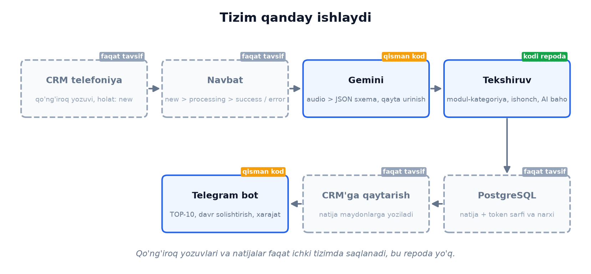
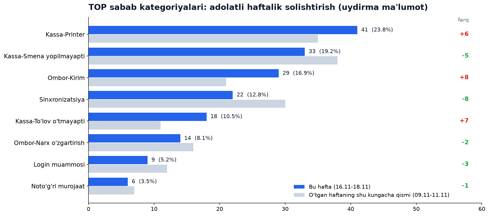

# Call-Center AI Analytics

[](https://github.com/navruzbek1/call-center-ai-analytics/actions/workflows/ci.yml)

> **English summary.** A system I built that listens to call-center recordings with Gemini and turns every
> call into structured data: transcript, product module, reason category, problem type, call state,
> operator tone and a criteria-based quality score. Results are stored in a database, a CRM integration
> module pulls new calls and writes results back, and a Telegram bot reports top issues, fair
> period-over-period comparisons and daily AI cost. This
> repository is a **case study with part of the core logic** (score recomputation, validation, Gemini
> resilience, period comparisons) and tests. The prompt, real categories, CRM integration, database and bot
> are not published. Contact: Telegram [@offon_ai](https://t.me/offon_ai). All rights reserved.

Call-center qo'ng'iroqlarini **AI tinglab chiqadi** va har bir qo'ng'iroqni avtomatik tahlil qiladi: mijoz
nima bilan murojaat qildi, muammo dastur xatosimi yoki tushunmovchilikmi, operator qanday ishladi. Natija
bazaga yoziladi, CRM integratsiya moduli uni qo'ng'iroq kartasiga qaytaradi, rahbariyat esa Telegram
orqali kunlik statistika va trendlarni ko'radi.

## Nima qiladi

Har bir qo'ng'iroqdan quyidagilar olinadi:

- so'zma-so'z **transkripsiya** va asosiy faktlar;
- qaysi **mahsulot va modul** haqida gap ketgani;
- **sabab kategoriyasi** (oldindan belgilangan ro'yxatdan);
- **muammo holati:** dastur xatosi, tushunmovchilik va boshqalar;
- **suhbat holati:** oddiy, to'satdan uzilgan yoki oldingi suhbatning davomi;
- **operator ohangi** va mezonlar bo'yicha **operatorga AI baho** (salomlashish, diagnostika va yechim,
  savollarga javob, xayrlashuv...);
- **ishonch darajasi:** past bo'lsa natija inson tekshiruviga belgilanadi.

Telegram bot: bugungi va umumiy statistika, **TOP-10 sabab kategoriyalari**, davrlarni adolatli
solishtirish (grafik bilan), kunlik token sarfi va xarajat, xatoliklar haqida ogohlantirish.

## Qanday ishlaydi



1. CRM telefoniyasida yangi qo'ng'iroq yozuvi paydo bo'ladi (holat: `new`).
2. Navbat uni oladi (`processing`), audioni yuklab, Gemini'ga JSON sxema bilan yuboradi.
3. Javob tekshiriladi: modul va kategoriya mosligi, ishonch, AI baho mezonlardan qayta hisoblanadi.
4. Natija va token sarfi bazaga yoziladi, CRM kartasiga qaytariladi (`success`). Xato bo'lsa karta
   `error` bosqichiga o'tadi va operator buni ko'radi.
5. Telegram bot bazadan hisobot va grafiklarni yaratadi.

## Nimalarda ishlatsa bo'ladi

- **Murojaatni to'g'ri mutaxassisga yo'naltirish:** kategoriya va modul darhol ma'lum bo'ladi.
- **Operator sifatini nazorat qilish:** har bir qo'ng'iroq bahosi va qaysi mezon zaifligi. Bu o'qitish
  rejasini aniq qiladi.
- **Mahsulotdagi muammoni erta sezish:** biror kategoriya keskin ko'paysa (masalan yangilanishdan keyin),
  bu haftalik solishtirishda darhol ko'rinadi.
- **Qo'llanma kerak joylarni topish:** "tushunmovchilik" ko'p bo'lgan mavzular FAQ yoki video qo'llanma
  kerakligini ko'rsatadi.
- **AI xarajatini boshqarish:** har bir qo'ng'iroq narxi va kunlik jami narx kuzatiladi.



## Muhandislik qarorlari

- **AI bahosi qayta hisoblanadi** ([`scoring.py`](callanalytics/scoring.py)). Model JSON'ni sxema tartibida
  yozadi, yakuniy ball esa mezonlardan oldin keladi. Shuning uchun model ba'zan mezonlar yig'indisiga mos
  kelmaydigan ball yozadi. Yakuniy ball koddagi mezon ballaridan hisoblanadi, model yozgani esa solishtirish
  uchun saqlanadi.
- **Natija tekshiriladi** ([`validation.py`](callanalytics/validation.py)). Kategoriya tanlangan modulga
  tegishli bo'lmasa, u "NOANIQ HOLAT" ga tushiriladi va ishonch pasaytiriladi. Ishonch past bo'lsa, natija
  inson ko'rib chiqishiga belgilanadi.
- **Barqarorlik** ([`resilience.py`](callanalytics/resilience.py)):
  - server xatolari va 429 da eksponensial kutish bilan qayta urinish, buzuq JSON qayta so'raladi;
  - xarajat chegarasi tugasa, bu xato emas, pauza: qo'ng'iroq keyinroq qayta olinadi;
  - Gemini mazmunni doimiy bloklasa (`PROHIBITED_CONTENT`), qayta urinilmaydi;
  - `processing` da osilib qolgan qo'ng'iroqlar vaqt chegarasidan keyin `error` ga o'tkaziladi va
    ogohlantirish yuboriladi;
  - allaqachon tahlil qilingan qo'ng'iroq qayta ishlanmaydi.
- **Har bir qo'ng'iroq narxi:** token sarfi modallik bo'yicha (audio, matn) saqlanadi.
- **Adolatli solishtirish** ([`periods.py`](callanalytics/periods.py)). Chorshanba kuni "bu hafta" o'tgan
  haftaning to'liq 7 kuni bilan emas, uning ham chorshanbagacha bo'lgan qismi bilan solishtiriladi. Oylar
  ham shunday, qisqa oylar hisobga olingan.

## Bu repoda nima bor

| Qism | Holati |
|---|---|
| AI bahosini qayta hisoblash, natijani tekshirish | kodi bor |
| Gemini uchun qayta urinish, kvota va blokni aniqlash, token hisobi | kodi bor |
| Hisobot davrlari va TOP-N | kodi bor |
| JSON sxema namunasi (uydirma kategoriyalar bilan) | [`schema_example.py`](callanalytics/schema_example.py) |
| Testlar (31 ta) | [`tests/`](tests) |
| Prompt va domen qoidalari, haqiqiy kategoriyalar, CRM integratsiyasi, baza, Telegram bot, qo'ng'iroq yozuvlari | **yo'q, faqat tavsif** |

## Texnologiyalar

Python, Gemini API (audio, tuzilmali JSON javob), PostgreSQL, CRM (Bitrix24) REST API, Telegram Bot API,
matplotlib.

## Testlar

```bash
pip install -e ".[dev]"
python -m pytest
```

Rasmlarni qayta yaratish: `PYTHONPATH=. python docs/make_images.py`.

## Aloqa

Tizimni o'z call-centeringizda ishlatish, sinab ko'rish yoki hamkorlik bo'yicha Telegram'da yozing:
**[@offon_ai](https://t.me/offon_ai)**.

© 2026 Navruzbek Abduganiyev. Barcha huquqlar himoyalangan. Kodni ishlatish yoki tarqatish uchun
oldindan ruxsat oling.
