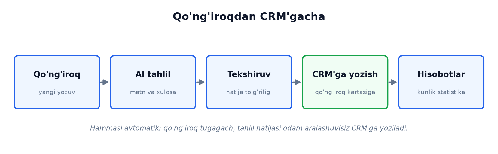

# Call-Center AI Analytics

> **English summary.** A system I built that listens to call-center recordings with AI, analyzes each call
> automatically and writes the result into the CRM. Managers get daily statistics and trends. This
> repository is a short description only; the code is not published. To design a similar AI system for
> your business, contact me on Telegram: [@offon_ai](https://t.me/offon_ai). All rights reserved.

Call-center qo'ng'iroqlarini **AI tinglab chiqadi**, har bir qo'ng'iroqni avtomatik tahlil qiladi va
natijani **CRM'ga yozib beradi**.

## Nima qiladi

- Qo'ng'iroqni matnga aylantiradi va qisqa xulosa yozadi.
- Murojaat mavzusini va muammo turini aniqlaydi.
- Operator xizmatini baholaydi.
- Natijani CRM'dagi qo'ng'iroq kartasiga avtomatik yozadi.
- Rahbariyat uchun kunlik statistika va trendlarni tayyorlaydi.

## Nimalarda foydali

- Har bir qo'ng'iroqni qo'lda tinglash va to'ldirish shart emas.
- Qaysi muammolar ko'payayotgani darhol ko'rinadi.
- Operatorlarning kuchli va zaif tomonlari aniq bo'ladi, o'qitishni rejalashtirish osonlashadi.
- AI xarajati har bir qo'ng'iroq bo'yicha kuzatib boriladi.

## Texnologiyalar

Python, Gemini API, PostgreSQL, CRM REST API, Telegram Bot API.

## Aloqa

Shunga o'xshash AI tizimlarini loyihalash va joriy qilish bo'yicha Telegram'da yozing:
**[@offon_ai](https://t.me/offon_ai)**.

© 2026 Navruzbek Abduganiyev. Barcha huquqlar himoyalangan.
